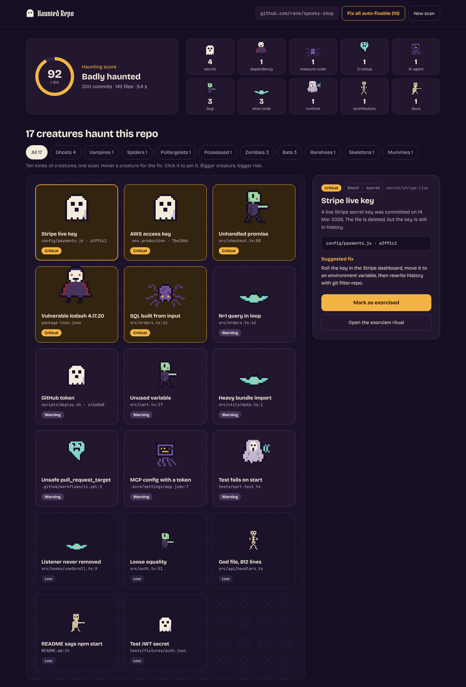

# 👻 Haunted Repo

**Your git history is haunted.** You deleted the API key months ago. It is still in commit `a3f91c2`, waiting.
Haunted Repo scans a GitHub repository, its history and its dependencies, and shows every problem as a creature you can banish.


Kiroween 2026 · Costume Contest · MIT license

## Ten kinds of trouble, one scan

| Creature | Finds | Fix |
|---|---|---|
| Ghost | Leaked keys and tokens in files and the last 300 commits | Exorcism ritual, GitHub token revocation, decoy canary |
| Vampire | Dependencies with known advisories (OSV.dev) | Smallest safe upgrade as a diff |
| Spider | SQL built from input, eval, innerHTML, shell commands, TLS off, CORS * | Diff where safe, proof test in the séance room |
| Poltergeist | `pull_request_target` checkouts, script injection, unpinned actions, `.env` not ignored | Diffs and pinned actions |
| Possessed | Tokens in MCP configs, model output into a shell, unsafe agent instructions | Safer config, clear warnings |
| Zombie | Bugs from ESLint: floating promises, loose equality, dead code | ESLint fix as a diff |
| Bat | Queries in loops, whole-library imports, listener leaks | Rewrite with the reason |
| Banshee | Failing tests and crashes in a sealed sandbox | Proven fix (séance room) |
| Skeleton | God files, no tests, no CI, raw SQL; stack card | Advice with evidence and confidence |
| Mummy | README that disagrees with the code, missing SECURITY.md, no agent files | SECURITY.md and README diffs |

Bigger creature, bigger risk. Fix them and the **Haunting score** drops.



## What you can do

| Screen | What happens |
|---|---|
| `/` | Scroll through the front door into the hallway. Tilt and flip the 3D trading cards. |
| `/house` | Creatures first. Hover one: a popup previews the fix and opens a pull request in your repo. A terminal shows score, counts and commands. Tour on first visit. |
| `/exorcism/[id]` | Four-step ritual with commands, boss-fight HP, rescan, decoy ghost. |
| `/hunt` | Creatures walk through the hallway. Hover to freeze, click to banish. |
| `/seance` | Live: clone, install, build and test your repo in a Vercel Sandbox, streamed like a terminal. Demo repo: prepared run with proof test. |
| `/report` | Autopsy report (print to PDF, Markdown), CycloneDX SBOM, README badge. |

Try it without a key: **Try a haunted demo repo** on the landing page.

## Fix it in your repo

1. Install the [Haunted Repo GitHub App](https://github.com/apps/haunted-repo) on your repo.
2. Log in with GitHub on the house page.
3. Hover a creature and click **Fix it in the repo**, or run `haunted-repo fix --pr` in the terminal panel for all auto-fixes.

Every pull request goes to a new branch. Each changed spot carries a `// haunted-repo: <rule>` comment, so reviewers see what moved. Secrets are never auto-fixed.

## Guard your repo

```
npx haunted-repo scan               # offline scan of the working tree
npx haunted-repo scan owner/repo    # scan a public GitHub repo
npx haunted-repo install-hook       # block commits that add a secret
npx haunted-repo watch              # move secrets from saved files into .env.local (with undo)
npx haunted-repo mcp                # MCP server for Kiro and other agents
```

### Kiro Power

`power/` is a Kiro Power (`plugin.json`, `mcp.json`, a skill). In Kiro: **Powers → Add Custom Power → Import power from a folder** and pick `power/`. Tools: `scan_file`, `scan_directory`, `scan_repo`, `explain_finding`, `suggest_fix`, `autopsy_report`.

## Security promises

- Secrets are masked to a type prefix plus at most 4 characters, and only shown for the demo or a proven owner. Other repos get a private disclosure draft instead.
- Raw values never leave the scanner. GitHub tokens can be revoked through a sealed handle that only the server can open.
- Your AI key stays in the tab's memory. You see exactly what is sent before the first call.
- The watcher and the pre-commit hook never use the network.
- Your GitHub login token stays in an encrypted httpOnly cookie. Only people with push access see masked secrets or can start a séance.
- Every POST route checks the Origin and is rate limited.

## How Kiro is used

| Kiro feature | Where |
|---|---|
| Specs | `.kiro/specs/` — scanner-core, scanners, creatures-ui, exorcism, ai-medium, watcher-cli, kiro-power, seance-room, autopsy-report, decoy-ghost, github-app, fix-popup, onboarding |
| Steering | `.kiro/steering/security.md`, `product.md`, `tech.md` |
| Hooks | `.kiro/hooks/secret-check.json` (scan on save, check before the agent stops), `test-on-save.json` |
| MCP | `.kiro/settings/mcp.json` runs Haunted Repo's own MCP server on this repo |
| Power | `power/` |
| Custom agent | `.kiro/agents/ghost-hunter.md` adds a rule plus tests from a template |
| Property-based tests | fast-check: masking never shows more than 4 characters, every scanner returns valid findings and never throws, the score is monotonic, watcher replace + undo is the identity |

## Develop

```
corepack enable
pnpm install
pnpm test          # core, CLI and web tests
pnpm dev           # http://localhost:3000
pnpm build:cli     # bundle the CLI to packages/cli/dist
```

Set `GITHUB_TOKEN` (read-only, public repos) for real scans. For login and fix PRs also `GITHUB_CLIENT_ID` and `GITHUB_CLIENT_SECRET` of the GitHub App. Vercel: Root Directory `apps/web`.

Layout: `apps/web` (Next.js), `packages/core` (scanners, no I/O), `packages/github`, `packages/cli`, `packages/mcp`, `power/`, `tools/` (sprite and art generators).

## Credits

Pixel art, sprites and scenes are hand-made for this project (`tools/sprites`, `tools/art`). Fonts: Pirata One, Bricolage Grotesque, JetBrains Mono (SIL Open Font License).
